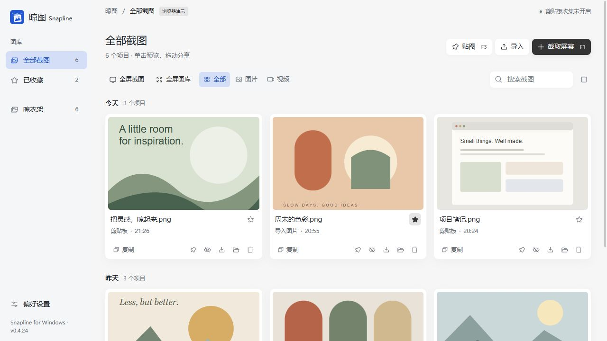

<p align="center">
  
</p>
<h1 align="center">Snapline · 晾图</h1>
<p align="center">把截图晾在屏幕边上，随手取用。</p>
<p align="center">Windows · Rust · Tauri 2 · React · MIT</p>
<p align="center">
  <a href="docs/USER-GUIDE.md">使用指南</a> ·
  <a href="docs/PRIVACY.md">隐私与数据</a> ·
  <a href="docs/OPTIONAL-ASSETS.md">可选素材</a> ·
  <a href="CONTRIBUTING.md">参与贡献</a> ·
  <a href="docs/VERIFICATION.md">验证范围</a>
</p>

Snapline 是一个本地优先的 Windows 截图与贴图工具。截图、标注、贴到桌面，再把常用图片挂在顶部晾衣架上；资料库负责收藏、搜索和整理。



<p align="center"><sub>浏览器演示，使用生成的示例图片；原生功能需 Windows 桌面版。</sub></p>

## 能做什么

| 场景 | 操作 |
| --- | --- |
| 截图与标注 | 区域截图、鼠标所在屏幕全屏截图；形状、箭头、文字、序号、马赛克、模糊与实色遮盖 |
| 桌面贴图 | 独立置顶、拖动、缩放、透明度、缩略图；右键使用独立的 Windows 原生菜单 |
| 顶部晾衣架 | 固定入口可拖动；横向浏览、单击复制、长按标注、文件拖入与拖出 |
| 图片查看 | 鼠标锚定缩放、拖动平移、适应窗口和 100%；全屏瀑布流与左右切图 |
| 整理与收藏 | 搜索、收藏、导出；从晾衣架收起或恢复图片，不删除图库副本 |
| 本地收集 | 监视指定截图目录；可选剪贴板图片收集，默认关闭 |
| 轻量装饰 | 原创伙伴、绳子回弹和彩色流光；遵循系统的减少动态效果偏好 |

## 开始使用

目标系统为 **Windows 10 / 11 x64**，需要 Microsoft Edge WebView2 Runtime。使用发布包中的 `Snapline.exe`，或运行 `Snapline_<版本>_x64-setup.exe` 安装。WebView2 缺失时，安装运行时可能需要联网；当前构建没有代码签名证书。

| 默认全局快捷键 | 功能 |
| --- | --- |
| **F1** | 区域截图 |
| **F3** | 把剪贴板图片贴到屏幕；截图过程中贴出当前选区 |
| **Ctrl+Alt+T** | 展开 / 收起晾衣架 |

快捷键可在设置中修改；被其他软件占用时以注册提示为准。关闭主窗口后应用仍驻留托盘，完全退出请使用托盘菜单。

“截图时隐藏晾图窗口”**默认关闭**：截图会保留当时可见的设置界面、灵动岛等应用窗口。开启后会临时隐藏，截图结束或取消时恢复。完整操作见[使用指南](docs/USER-GUIDE.md)。

## 开发与构建

准备 Node.js 22、Rust stable 的 MSVC 工具链（项目最低要求 1.90）、Visual Studio C++ 构建工具、Windows SDK 和 WebView2。安装说明见 [Tauri Windows 前置要求](https://v2.tauri.app/start/prerequisites/)。

在项目根目录运行：

```powershell
npm.cmd ci
npm.cmd run tauri -- dev
```

只看界面可运行 `npm.cmd run dev`，打开 `http://127.0.0.1:1420`。浏览器演示使用生成的示例图片，不具备真实截图、全局快捷键和原生拖放能力；桌面版首次启动为空资料库。

```powershell
npm.cmd test
npm.cmd run build
cargo fmt --manifest-path src-tauri/Cargo.toml --check
cargo test --manifest-path src-tauri/Cargo.toml --locked
cargo clippy --manifest-path src-tauri/Cargo.toml --locked -- -D warnings
.\scripts\build.ps1
```

完整构建输出到 `release/`，包括免安装可执行文件、当前版本 NSIS 安装包和 `SHA256SUMS.txt`。只生成免安装版可运行 `.\scripts\build.ps1 -PortableOnly`。原始 Tauri 产物位于 `src-tauri/target/release/`；两个锁文件应保留。

角色包括 **8 款原创矢量伙伴与 4 套维护者提供的外部素材**，共 12 款，支持同时选择 1–3 只混搭。四套外部图片的版权归原作者，原始作者和授权尚未核实，不适用本项目 MIT 许可；使用时需按其适用许可处理。删除这些图片后仍可构建仅含 8 款原创角色的版本。详见[角色素材说明](docs/OPTIONAL-ASSETS.md)。

## 项目结构

```text
src/                  React 界面、截图覆盖层、贴图、晾衣架与查看器
src/editor/           标注模型、像素渲染与历史记录
src-tauri/src/        Rust 图库、Windows 捕获、剪贴板、OLE 与窗口管理
src-tauri/icons/      原创应用图标
scripts/              Windows 构建、图标生成与发布辅助脚本
docs/                 使用、隐私、素材说明与验证范围
docs/assets/          原创 SVG / PNG 标志
.github/workflows/    Windows 自动检查与构建
```

## 当前边界

- 目前面向 Windows x64；不提供可用的 macOS / Linux 发行版。
- 尚无 OCR、滚动长截图、窗口/控件自动识别、图片旋转、贴图穿透或贴图会话跨重启恢复。
- 标注保存为扁平 PNG；已落笔对象不能事后选中移动，可撤销后重画。没有内置录屏或视频时间线编辑。
- 真实双屏同为 100% 的部分场景已有历史实测；混合 DPI、HDR、负原点布局及特殊全屏应用仍需对应硬件验证。几何单元测试不能替代实机结论。
- 拖出提供文件副本，目标应用决定是否接受；不宣称与 Snipaste 完整功能对等。

已执行范围见[验证记录](docs/VERIFICATION.md)，待验场景见[原生测试清单](docs/TEST-PLAN.md)。

## 来源与许可

晾衣架交互源自 Alejandro Buján 的 [Tendedero](https://github.com/alejandrobujan/tendedero)。Snapline 使用 Rust、Tauri 和 React 独立重写 Windows 实现，采用新的名称与原创标志；这是非官方项目，与原作者无隶属或背书关系。上游对 Tendedero 名称和图标的限制仍需遵守。

截图与贴图工作流参考 [Snipaste](https://www.snipaste.com/)，紧凑顶部入口参考 [Apple Dynamic Island](https://developer.apple.com/design/human-interface-guidelines/live-activities)；这些说明不代表相关产品参与或背书。界面图标使用 [Phosphor Icons](https://github.com/phosphor-icons/react)。

项目代码、原创 Logo 与 8 款原创矢量角色采用 MIT 许可；外部图片不因此获得 MIT 授权。许可与保留的版权声明见 [LICENSE](LICENSE)，第三方组件及素材边界见 [THIRD_PARTY_NOTICES.md](THIRD_PARTY_NOTICES.md)。
